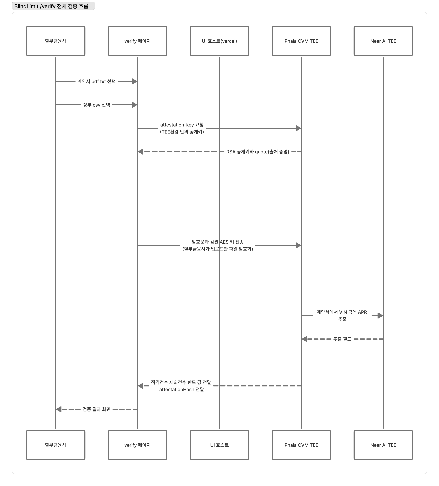

# BlindLimit

할부금융사가 **계약서(PDF·이미지)와 대출장부**를 사람이 전수 대사하기 전에, **TEE 안에서 AI 추출 + 결정론 코드**로 자가 검증을 빠르게 돌리는 프라이버시 담보 검증 레이어입니다. 핵심은 대출을 중개하는 풀이 아니라 **원문을 외부에 노출하지 않는 검증**입니다. 이를 온체인으로 확장하면, 같은 검증 결과를 온체인 대출 풀의 담보 한도·집행(`postLimit` / `borrow`)까지 연결할 수 있습니다.

## 사용 대상

| | |
|--|--|
| **주 사용자** | **할부금융사** (`/verify`) — 계약서↔장부 조인, 연체·금액·금리 불일치, 이중 VIN 등 이상을 **BBC/담보 신고 전에** 빨리 찾음 |
| **왜 쓰나** | 실무상 일상 점검은 내부가 하고, 은행은 샘플·실사로 견제함. 병목은 **원문 계약과 장부를 맞추는 시간**. BlindLimit은 그 셀프 점검 속도를 올림 |
| **2차** | 은행·풀 운영자는 적격 건수·제외 사유 집계만 **실사·한도 판단 참고**로 사용 (맹신·최종 승인 대체 아님) |
| **온체인 확장 가능성** | `/lender` — 검증 결과를 풀 한도에 연결해 `postLimit` / `borrow` **집행까지** 이어질 수 있음 |

## Privacy: 왜 TEE 안에서 AI와 코드가 돌아가야 하나

### 계약서에 포함된 민감정보들

할부계약 원문에는 외부 유출을 꺼리는 정보가 포함되는 것이 일반적입니다.

- 차주 성명·주민번호(또는 이에 준하는 ID)·주소·전화
- 할부원금·금리·월 납입·보증인
- VIN·차량·딜러, 서명·계좌 등

장부(CSV/엑셀)에도 잔여원금·연체·차주/딜러 키가 있습니다. 원문을 일반 클라우드·운영자·체인에 올리면 **개인정보·금융비밀·포트폴리오 노출** 위험이 큽니다. 그래서 은행에도 원문 전량보다 테이프·BBC·샘플을 넘기는 관행과 맞습니다.

### TEE에서 하는 일 / 밖으로 안 나가는 것

| TEE 안 (민감) | TEE·서버 밖 (공개 가능) |
|---------------|-------------------------|
| PDF·스캔 이미지·텍스트 계약서 **원문** | 문서·영수증·규칙 **해시** |
| **AI(비전/LLM)** 로 계약서에서 VIN·금액·금리 등 **필드 추출만** | 적격 건수·합계·한도, 제외 사유별 **건수** |
| 장부 파싱·VIN 조인·한도 산정 **결정론 코드** (`lib/rules`) | 온체인 이벤트·집계 JSON |

- **AI 역할:** 숫자 판단·한도 결정이 아님. 이미지/PDF 계약서를 인식해 구조화 필드만 뽑음. 한도·적격 여부는 **같은 입력 → 같은 출력**인 규칙 코드가 담당.
- **왜 enclave인가:** 추출·대사 과정에서 원문이 메모리에 잠깐이라도 올라가므로, 운영자·호스트·로그·클라이언트가 원문을 못 읽게 **TEE(NEAR AI Cloud 등) 안에서** 돌리는 것이 프라이버시 전제. Incognito(비-TEE) 모델은 사용하지 않음.
- **제3자가 보는 것:** 해시와 집계뿐. “차주 아무개의 계약”이 아니라 “금액 불일치 N건, 이중 담보 M건” 수준의 참고 자료.

*(현재: `/verify` 암호 업로드는 브라우저에서 봉인한 뒤 **Phala CVM(TEE)** 에서 복호·`lib/rules` pipeline을 돌리고, 계약 필드 추출은 **NEAR AI Cloud TEE**에 맡깁니다. UI 호스트는 RSA 개인키가 없어 원문을 볼 수 없습니다.)*

## Borrowing Base Certificate란?

**BBC (Borrowing Base Certificate):** 할부금융사가 은행·에이전트에 제출하는 담보 한도 신고(또는 테이프+요약). **1차는 할부금융사가 작성**, 은행은 샘플링·필드 실사로 견제. BlindLimit은 그 **작성·사전 자가 점검**을 가속합니다.

## 장부, 계약서 검증 흐름

### 업로드 파일 암호화 과정
1. 브라우저가 일회용 AES 키를 만듦
2. 해당 AES 키로 계약서·장부를 암호화
3. AES 키를 TEE의 RSA 공개키로 감쌈
4. TEE만 가진 RSA 개인키로 AES 키를 풀고 → AES로 원문 복호화
5. Near AI 추출 + rules 계산 → 집계·해시만 금융사에 반환

### 전체 흐름
할부금융사가 /verify에서 계약서(.pdf/.txt)와 장부(.csv)를 고릅니다. 브라우저가 CVM에 RSA 공개키(및 quote)를 받은 뒤, 위처럼 봉인해 암호문 + 감싼 AES 키만 CVM으로 보냅니다. UI 호스트(Vercel 등)는 개인키가 없어 원문을 볼 수 없습니다.

CVM(TEE)에서 RSA로 AES 키를 복원하고 파일을 풀어, Near AI TEE에 계약 추출을 맡기고, 장부와 VIN 조인·연체·한도 등 결정론 코드를 돌립니다. 끝나면 적격 건수·제외 사유 건수·한도·attestationHash 같은 집계만 금융사 화면에 돌아갑니다.